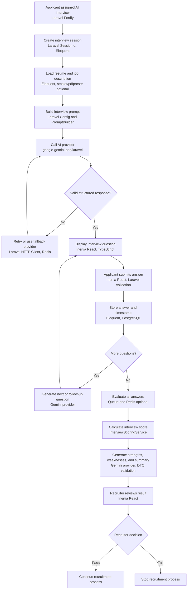
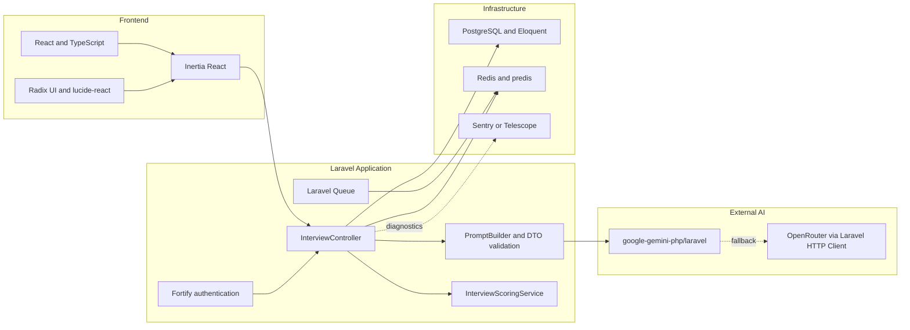

# AI Interview Specifications

## 1. Document Purpose

This document defines the technical scope for extending `ai-int-test` from a deterministic interview prototype into an AI-assisted recruitment interview module.

The specification is based on the recruitment flow diagram and the reusable patterns identified in the `ApplyAI` repository.

## 2. Scope

The interview module begins after an applicant is approved for online testing and ends when the interview result is available for recruiter review.

### In scope

- Creating an interview session
- Asking generated or configured interview questions
- Collecting applicant answers
- Sending interview context to an AI provider
- Validating structured AI responses
- Scoring answers
- Generating strengths, weaknesses, and a summary
- Showing the result to a recruiter
- Handling provider failures and incomplete sessions

### Out of scope for the first version

- Voice or video interviews
- Automatic final hiring decisions
- Real-time streaming responses
- Resume upload and PDF parsing
- External job-board scraping
- Multi-tenant administration

## 3. Current Prototype

The current `ai-int-test` implementation has these characteristics:

- Laravel 13 backend
- Inertia React frontend
- React 19 and TypeScript
- Session-based interview state
- Three fixed questions
- A deterministic `fakeResponse()` method
- No external AI provider
- No persistent interview tables
- No recruiter dashboard yet

The main current entry points are:

- `routes/web.php`
- `app/Http/Controllers/InterviewController.php`
- `resources/js/pages/interview/session.tsx`

## 4. Target Business Flow



### Library-to-flow mapping



The first diagram describes the business process. The second diagram identifies which libraries or technical components support each part of that process.

## 5. Recommended Technical Architecture

```text
InterviewController
        |
        v
InterviewSessionService
        |
        +--> PromptBuilder
        |
        +--> AiProviderInterface
        |        |
        |        +--> GeminiProvider
        |        +--> OpenRouterProvider (optional fallback)
        |
        +--> AiResponseValidator
        +--> InterviewScoringService
        +--> InterviewSummaryService
        +--> InterviewRepository
                         |
                         +--> PostgreSQL
                         +--> Redis (optional cache and queue)
```

### Component responsibilities

| Component                 | Responsibility                                                               |
| ------------------------- | ---------------------------------------------------------------------------- |
| `InterviewController`     | Validate requests, invoke application services, and return Inertia responses |
| `InterviewSessionService` | Start, advance, pause, complete, and reset interviews                        |
| `PromptBuilder`           | Combine question rules, resume context, job context, and prior answers       |
| `AiProviderInterface`     | Stable contract for all AI providers                                         |
| `GeminiProvider`          | Call Google Gemini and normalize its response                                |
| `OpenRouterProvider`      | Optional OpenAI-compatible fallback provider                                 |
| `AiResponseValidator`     | Reject malformed, incomplete, or unsafe AI output                            |
| `InterviewScoringService` | Produce consistent score and rubric results                                  |
| `InterviewSummaryService` | Produce recruiter-facing summary and recommendation                          |
| `InterviewRepository`     | Persist session, questions, answers, and results                             |

## 6. Recommended Libraries and Technologies

| Need                    | Recommended library or technology             | Priority | Reason                                                      |
| ----------------------- | --------------------------------------------- | -------: | ----------------------------------------------------------- |
| AI provider             | `google-gemini-php/laravel`                   |     High | Already used by `ApplyAI`; suitable for Gemini integration  |
| Provider abstraction    | Native PHP interface                          |     High | Prevents controllers from depending on one vendor           |
| HTTP fallback           | Laravel HTTP Client                           |   Medium | Suitable for OpenAI-compatible providers such as OpenRouter |
| Prompt configuration    | Laravel config files                          |     High | Keeps prompts versioned and editable                        |
| Structured output       | PHP DTOs plus validation                      |     High | Protects the application from malformed AI responses        |
| Frontend                | Inertia React                                 | Existing | Already used by `ai-int-test`                               |
| UI components           | Existing Radix UI and `lucide-react` packages | Existing | Already available in the frontend                           |
| Session prototype       | Laravel session                               | Existing | Fastest way to validate the interaction design              |
| Persistent storage      | Eloquent and PostgreSQL                       |     High | Required for history, recruiter review, and auditability    |
| Cache and rate limiting | Redis with `predis/predis`                    |   Medium | Useful for provider limits and temporary state              |
| Background work         | Laravel Queue with Redis                      |   Medium | Prevents long AI requests from blocking web requests        |
| Authentication          | Laravel Fortify                               | Existing | Already available in `ai-int-test`                          |
| API authentication      | Laravel Sanctum                               | Optional | Use if a separate mobile or external frontend is added      |
| PDF text extraction     | `smalot/pdfparser`                            |    Later | Only needed when resume upload is added                     |
| HTML to text            | `html2text/html2text`                         |    Later | Useful when job descriptions are fetched from web pages     |
| Testing                 | Pest                                          | Existing | Already used by `ai-int-test` and `ApplyAI`                 |
| Static analysis         | Larastan/PHPStan                              | Existing | Validates service contracts and DTOs                        |
| Error monitoring        | Sentry                                        |    Later | Useful for production provider failures                     |
| Local inspection        | Telescope                                     | Optional | Useful for debugging requests, jobs, and events             |

Do not copy the entire `ApplyAI` dependency set. Add only the dependencies needed by the interview slice and preserve the dependency versions resolved by `ai-int-test`.

## 7. AI Provider Contract

The application should depend on an internal contract rather than a vendor-specific client.

```php
interface AiProviderInterface
{
    /**
     * @return array<string, mixed>
     */
    public function generateStructuredResponse(
        string $systemPrompt,
        string $userPrompt,
    ): array;
}
```

The provider adapter should handle:

- API authentication
- Model selection
- Request timeout
- Provider-specific request format
- Provider-specific response format
- Retryable errors
- Logging without exposing secrets or applicant data unnecessarily

## 8. Prompt Design

Prompts should be stored in configuration or dedicated prompt files instead of being embedded in controllers.

### Question generation output

```json
{
    "question": "Describe a difficult problem you solved and how you approached it.",
    "type": "behavioral",
    "intent": "Evaluate problem solving and communication"
}
```

### Answer evaluation output

```json
{
    "score": 82,
    "strengths": [
        "Explains the situation clearly",
        "Describes a measurable result"
    ],
    "weaknesses": [
        "Does not clearly explain the applicant's individual contribution"
    ],
    "feedback": "Use a clearer STAR structure and identify the personal actions taken.",
    "recommendation": "acceptable"
}
```

The application must validate the response before storing or displaying it. It must not assume that an AI response is valid JSON or that every field is present.

## 9. Suggested Data Model

### `interview_sessions`

| Column             | Purpose                                                         |
| ------------------ | --------------------------------------------------------------- |
| `id`               | Session identifier                                              |
| `applicant_id`     | Applicant reference                                             |
| `vacancy_id`       | Vacancy or job reference                                        |
| `status`           | `assigned`, `in_progress`, `completed`, `failed`, or `reviewed` |
| `current_question` | Current question sequence                                       |
| `started_at`       | Start timestamp                                                 |
| `completed_at`     | Completion timestamp                                            |

### `interview_questions`

| Column                 | Purpose                                     |
| ---------------------- | ------------------------------------------- |
| `id`                   | Question identifier                         |
| `interview_session_id` | Parent session                              |
| `question`             | Question text                               |
| `question_type`        | `behavioral`, `technical`, or `situational` |
| `sequence`             | Display order                               |

### `interview_answers`

| Column                  | Purpose              |
| ----------------------- | -------------------- |
| `id`                    | Answer identifier    |
| `interview_question_id` | Related question     |
| `answer`                | Applicant response   |
| `score`                 | Answer score         |
| `feedback`              | AI feedback          |
| `submitted_at`          | Submission timestamp |

### `interview_results`

| Column                 | Purpose                                        |
| ---------------------- | ---------------------------------------------- |
| `id`                   | Result identifier                              |
| `interview_session_id` | Related session                                |
| `total_score`          | Final normalized score                         |
| `strengths`            | Structured strengths                           |
| `weaknesses`           | Structured weaknesses                          |
| `summary`              | Recruiter-facing summary                       |
| `recommendation`       | AI recommendation, subject to recruiter review |
| `recruiter_decision`   | Human final decision                           |

## 10. Interview State Machine

```text
assigned
   |
   v
in_progress --> abandoned
   |
   v
completed --> reviewed
   |
   v
failed
```

The state transition must be controlled by the backend. The frontend must not be able to mark an interview as completed or reviewed by itself.

## 11. Error and Edge-Case Handling

The diagram should show these technical branches:

- AI provider timeout
- Provider rate limit
- Provider unavailable
- Invalid or incomplete JSON response
- Retry limit reached
- Optional fallback provider used
- Empty answer
- Answer exceeds maximum length
- Duplicate answer submission
- Expired interview session
- Applicant leaves before completion
- Queue job failure
- Database failure
- Recruiter override

Recommended behavior:

1. Validate every applicant answer before sending it to an AI provider.
2. Use a bounded retry policy with exponential backoff.
3. Store provider status and request correlation IDs without storing API keys.
4. Mark the interview as `failed` when retries are exhausted.
5. Allow a recruiter to retry or manually review a failed interview.
6. Prevent duplicate submissions using idempotency checks or question-level locks.

## 12. Security and Privacy

- Keep AI API keys only in environment variables.
- Never send passwords, session cookies, or unrelated personal data to the provider.
- Minimize resume and applicant data included in prompts.
- Enforce authorization for applicant and recruiter actions.
- Do not trust score or recommendation values received from the browser.
- Escape or safely render AI-generated text in the frontend.
- Apply rate limiting to interview submission and AI-triggering endpoints.
- Record an audit trail for AI results and recruiter decisions.
- Treat AI output as decision support, not as the sole hiring decision.
- Define retention and deletion rules for resumes, answers, and AI results.

## 13. Testing Requirements

### Unit tests

- Prompt construction
- Resume and job-description truncation
- Structured response validation
- Score normalization
- State transitions
- Retry classification

### Feature tests

- Applicant can start an assigned interview
- Applicant can submit an answer
- Next question is returned
- Completed interview produces a result
- Invalid answer is rejected
- Guest cannot access protected interview data
- Duplicate submission does not create duplicate answers
- Provider failure produces a controlled application response

### Frontend tests

- Question and progress indicator render correctly
- Submit button shows a pending state
- Validation errors are visible
- Completed state displays the result
- Reset or restart behavior works as intended

## 14. Implementation Phases

### Phase 1: Prototype provider integration

- Add Gemini dependency
- Add environment configuration
- Create `AiProviderInterface`
- Create `GeminiProvider`
- Move prompts into configuration
- Replace `fakeResponse()` with one controlled AI call
- Keep session storage

### Phase 2: Structured interview flow

- Add generated question response validation
- Add answer evaluation
- Add score and summary display
- Add provider timeout and retry handling
- Add tests for success and failure paths

### Phase 3: Persistent recruitment workflow

- Add interview migrations and models
- Replace session-only state with database persistence
- Add applicant and vacancy relationships
- Add recruiter result view
- Add human decision fields and audit history

### Phase 4: Reliability and scale

- Add Redis rate limiting and caching
- Move long AI operations to queues
- Add fallback provider
- Add monitoring and structured logs
- Add retention and privacy controls

## 15. Initial Recommended Scope

The first implementation should remain small:

```text
Assigned
  -> Start session
  -> Ask configured question
  -> Submit answer
  -> Evaluate answer with AI
  -> Show feedback
  -> Ask next question
  -> Generate final score and summary
  -> Recruiter review
```

Use the existing session-based prototype until the interaction is validated. Then introduce database persistence, queues, Redis, and a fallback provider incrementally.

## 16. Relationship to ApplyAI

The most reusable ApplyAI patterns are:

- `google-gemini-php/laravel` for Gemini integration
- Dedicated AI service classes instead of putting provider calls in controllers
- Centralized prompts in configuration
- Strict JSON-shaped AI responses
- Resume and job-description truncation before prompt construction
- Pest and Larastan for quality checks

ApplyAI's root web page is only a Laravel welcome page because its primary surface is an API. Its backend services are useful references, while `ai-int-test` remains the visual interview client.
