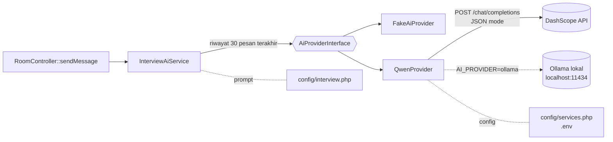

# Integrasi AI (Alibaba Qwen)

## Status

| Item | Status |
| --- | --- |
| Provider yang dipilih perusahaan | **Alibaba Qwen** (Model Studio / DashScope) |
| Akses API | ⏳ Belum ada. Sementara bisa memakai **Ollama** (Qwen open-source, lokal, gratis) dengan `AI_PROVIDER=ollama`, atau `AI_PROVIDER=fake` untuk balasan dummy |
| Kode integrasi | ✅ `QwenProvider` siap dan teruji dengan `Http::fake()` |
| Speech-to-text | Web Speech API browser (bukan Qwen) |

## Arsitektur



Controller tidak bergantung langsung pada Qwen. Untuk mengganti atau menambah provider, cukup buat class baru yang mengimplementasikan `AiProviderInterface`, lalu daftarkan di `AppServiceProvider`.

## Kontrak Data

**Input ke provider**: satu system prompt ditambah riwayat chat.

```json
[
  { "role": "assistant", "content": "Silakan perkenalkan diri Anda." },
  { "role": "user", "content": "Saya backend engineer selama 3 tahun..." }
]
```

Pemetaan role: `applicant` → `user`, `ai_assistant` → `assistant`.

**Output yang diwajibkan** (divalidasi `InterviewAiService`):

```json
{ "reply": "Apa tantangan terbesar di proyek tersebut?" }
```

Jika output tidak valid, provider gagal, atau API key kosong, sistem melempar `AiProviderException`. Controller lalu mengembalikan pesan error ke user, sementara jawaban applicant tetap tersimpan.

## Pengganti Sementara: Ollama (gratis, lokal)

Selama akses DashScope belum ada, model Qwen versi **open-weight** bisa dijalankan di laptop lewat [Ollama](https://ollama.com). Ollama menyediakan API yang kompatibel dengan OpenAI, jadi `QwenProvider` dipakai apa adanya. Perbedaannya hanya tidak ada API key dan timeout lebih panjang.

Kelebihannya: gratis, tanpa akun, dan **data kandidat tidak keluar dari laptop**. Prompt yang disetel sekarang tetap relevan karena keluarga modelnya sama.

1. Pasang Ollama dan unduh model (sekali saja, dari PowerShell):
   ```bash
   winget install Ollama.Ollama
   ```
   ```bash
   ollama pull qwen2.5:3b
   ```
2. Ubah `.env`:
   ```
   AI_PROVIDER=ollama
   OLLAMA_MODEL=qwen2.5:3b
   ```
3. Restart container: `docker compose up -d --force-recreate`. Di dalam Docker, `OLLAMA_BASE_URL` otomatis diarahkan ke `http://host.docker.internal:11434/v1` oleh `compose.yaml`.

| Model | Ukuran | Catatan (RAM 16 GB, GPU 4 GB) |
| --- | --- | --- |
| `qwen2.5:3b` | ±2 GB | Muat penuh di GPU, cepat. Default |
| `qwen2.5:7b` | ±4,7 GB | Lebih pintar, tapi sebagian jalan di CPU sehingga lebih lambat |

Catatan:
- Panggilan pertama setelah Ollama menyala lebih lambat karena model dimuat ke memori. Karena itu `OLLAMA_TIMEOUT` default 120 detik.
- Model 3B jelas kalah pintar dari `qwen-plus`. Pakai untuk menguji alur dan prompt, bukan untuk menilai kualitas akhir.
- Kalau container tidak bisa menghubungi Ollama (error "Ollama request failed"), jalankan Ollama dengan `OLLAMA_HOST=0.0.0.0` agar mendengarkan di semua interface.

## Mengaktifkan Qwen

1. Isi `.env`:
   ```
   AI_PROVIDER=qwen
   DASHSCOPE_API_KEY=sk-...
   QWEN_MODEL=qwen-plus
   ```
2. Jika akun Alibaba berada di region **China**, ubah juga:
   ```
   QWEN_BASE_URL=https://dashscope.aliyuncs.com/compatible-mode/v1
   ```
   API key dari satu region tidak berlaku di region lain.
3. Jalankan `php artisan config:clear`.
4. Uji satu sesi interview, lalu setel prompt di `config/interview.php`.

### Yang perlu dikonfirmasi ke pemberi akses
- Region akun (internasional atau China)
- Model yang diizinkan (`qwen-plus` / `qwen-max` / `qwen-turbo` / `qwen-flash`)
- Rate limit dan kuota, terutama jika banyak applicant sekaligus
- Biaya per token
- Kebijakan penyimpanan data kandidat

## Bahasa Indonesia & Istilah Perusahaan

**Kesimpulan: tidak perlu training.** LLM Qwen sudah memahami Bahasa Indonesia. Istilah perusahaan cukup ditangani dengan glosarium di prompt dan kamus STT. Fine-tuning hanya opsi terakhir.

| Cara | Kapan dipakai | Catatan |
| --- | --- | --- |
| **Glosarium di prompt** | Langkah pertama | Daftar istilah + arti di `config/interview.php`. Tanpa biaya training, bisa langsung diubah |
| **Kamus STT** | Bersamaan dengan glosarium | Perluas pola `jaksel-normalizer.ts` untuk mengoreksi salah tangkap STT (misal "jidi pi es" → "GDPS") |
| **RAG** | Dokumen perusahaan banyak (SOP, job description) | Ambil potongan dokumen yang relevan, lalu sisipkan ke prompt |
| **Fine-tuning** | Gaya wawancara masih belum sesuai | Lihat kendala di bawah |

**Kendala:**
- **Qwen3-ASR** versi open-source mendukung Bahasa Indonesia, tetapi dukungan di **API Model Studio** untuk region akun kalian masih perlu dicek. Sampai terbukti lebih akurat, STT tetap memakai browser.
- **Qwen TTS** belum terlihat mendukung Bahasa Indonesia. Untuk suara AI, pakai TTS browser `id-ID` atau penyedia lain.
- Fine-tuning butuh sekitar **1.000 contoh** berkualitas, ada biaya training dan hosting, dan hanya tersedia untuk model tertentu. Dukungan untuk `qwen-plus` belum pasti.
- Fine-tuning **tidak andal** untuk menghafal istilah atau fakta. Kalau istilah berubah, model harus dilatih ulang.

## Rencana Lanjutan

| Prioritas | Pekerjaan |
| --- | --- |
| Tinggi | Glosarium istilah perusahaan (prompt + normalizer) |
| Tinggi | Konteks interview per room: posisi, job description, jumlah pertanyaan |
| Tinggi | Panggilan AI lewat **queue**, balasan dikirim lewat Reverb, supaya request tidak menggantung saat Qwen lambat |
| ~~Tinggi~~ | ✅ Perbaikan role `interviewer` di `interview_messages` |
| Sedang | Evaluasi akhir: skor, kelebihan, kekurangan, ringkasan (`interview_results`) |
| Sedang | Dashboard review recruiter |
| Sedang | Rate limit per room/applicant |
| Rendah | Text-to-speech untuk pertanyaan AI |
| Rendah | Memakai `AiProviderInterface` juga di prototype `/interview` |

Semua pekerjaan di atas bisa dibuat dan dites dengan `FakeAiProvider` sebelum akses API tersedia.

## Multi-Applicant dalam Satu Sesi

Requirement menyebut **1 interviewer untuk banyak applicant dalam 1 sesi**. Ada dua cara menafsirkannya:

| | **A. Interview paralel** (direkomendasikan) | **B. Group interview** |
| --- | --- | --- |
| Konsep | Setiap applicant diwawancarai AI secara terpisah, bersamaan | Semua applicant berada di satu ruang, AI memandu bergiliran |
| Video antar-applicant | Tidak perlu | Perlu SFU (misal LiveKit), karena WebRTC P2P hanya kuat untuk 2–3 orang |
| Keadilan penilaian | Tinggi, setiap kandidat mendapat waktu dan pertanyaan setara | Rawan bias, kandidat bisa saling memengaruhi |
| Kompleksitas | Sedang, sebagian besar di backend | Tinggi: turn-taking, atribusi pembicara |

Perubahan yang dibutuhkan untuk model A:
1. Tabel `interview_participants`. Riwayat AI dipisah per applicant, bukan per room.
2. `InterviewAiService` hanya membaca riwayat applicant tersebut.
3. Batas 2 peserta di `RoomPresenceService` diganti kapasitas sesi yang bisa diatur.
4. WebRTC antar-applicant dihapus. Recruiter manusia cukup mendapat tampilan pantau.
5. Rekaman dan pelanggaran dicatat per applicant.
6. Panggilan AI wajib lewat queue, dan perlu dipastikan masih dalam rate limit Qwen.

Model yang dipakai masih menunggu keputusan.

## Referensi

- [AI_INTERVIEW_SPECIFICATIONS.md](../AI_INTERVIEW_SPECIFICATIONS.md): spesifikasi target modul AI
- [Model Studio: Improve ASR accuracy](https://www.alibabacloud.com/help/en/model-studio/improve-asr-accuracy)
- [Model Studio: Custom hot words](https://www.alibabacloud.com/help/en/model-studio/custom-hot-words-user-guide)
- [Model Studio: Model training overview](https://www.alibabacloud.com/help/en/model-studio/model-training-overview)
