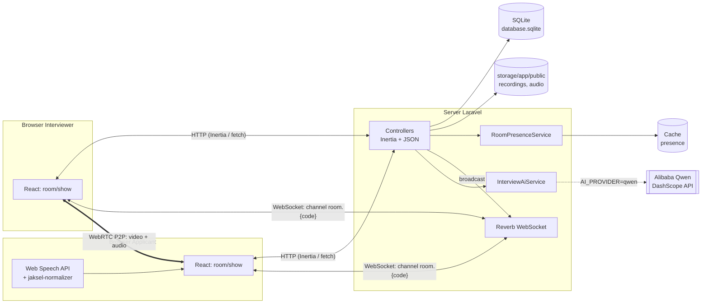

# Arsitektur & Struktur Proyek

Dokumen ini menjelaskan teknologi yang dipakai, komponen utama, dan letak setiap bagian kode.

## 1. Gambaran Umum

`ai-int-test` adalah aplikasi web untuk **interview kerja online** antara *interviewer* dan *applicant*, yang nantinya dipandu oleh AI (Alibaba Qwen). Fitur yang sudah ada:

| Fitur | Status |
| --- | --- |
| Login, registrasi, 2FA, passkey (Fortify) | ✅ Jalan |
| Role user: `interviewer` / `applicant` | ✅ Jalan |
| Room interview dengan kode 6 karakter | ✅ Jalan |
| Video call 1:1 (WebRTC peer-to-peer, signaling lewat Reverb) | ✅ Jalan |
| Batas 2 peserta per room (presence heartbeat) | ✅ Jalan |
| Proctoring applicant (pindah tab / keluar jendela) dan mode fullscreen | ✅ Jalan |
| Speech-to-text di browser (Web Speech API, mode campuran ID–EN) | ✅ Jalan |
| Indikator border hijau saat peserta bicara | ✅ Jalan |
| Rekaman meeting (video + audio terpisah), simpan dan putar ulang | ✅ Jalan |
| Chat transkrip → balasan AI | ⚠️ Memakai `FakeAiProvider` (balasan dummy) |
| Integrasi Qwen (`QwenProvider`) | ⏳ Kode siap, menunggu akses API |
| Skor, ringkasan, dan dashboard recruiter | ❌ Belum ada |

## 2. Tech Stack

| Lapisan | Teknologi |
| --- | --- |
| Backend | PHP 8.3+, **Laravel 13** |
| Frontend | **Inertia.js 3** + **React 19** + TypeScript, Tailwind CSS 4, Radix UI, `lucide-react`, `sonner` (toast) |
| Build tool | Vite 8 (lewat `vp`), Laravel Wayfinder |
| Autentikasi | Laravel Fortify (login, register, reset password, 2FA, passkey) |
| Realtime | **Laravel Reverb** (WebSocket) + `@laravel/echo-react` |
| Video/audio | WebRTC (`RTCPeerConnection`), `MediaRecorder`, Web Audio API |
| Speech-to-text | Web Speech API browser (`SpeechRecognition`) |
| AI | `AiProviderInterface` → `FakeAiProvider` / `QwenProvider` (DashScope, OpenAI-compatible) |
| Database | SQLite (lokal), bisa diganti PostgreSQL/MySQL |
| Cache / session / queue | Driver `database` |
| Penyimpanan file | Disk `public` (`storage/app/public`) |
| Testing & kualitas | Pest, PHPStan (Larastan), Pint, `vp check` |

## 3. Diagram Sistem



Poin penting:
- **Video dan audio tidak lewat server.** Keduanya mengalir langsung antar-browser (WebRTC P2P). Server hanya meneruskan *signaling* (offer, answer, ICE) lewat Reverb.
- **STT berjalan di browser.** Server hanya menerima teks hasil transkripsi.
- **AI dipanggil dari server**, sehingga API key tidak pernah sampai ke browser.

## 4. Struktur Folder

Hanya folder dan file yang relevan untuk fitur interview yang ditampilkan.

```text
ai-int-test/
├── app/
│   ├── Events/
│   │   └── WebRTCSignal.php              # Event broadcast ke channel room.{code}
│   ├── Http/Controllers/
│   │   ├── RoomController.php            # Buat/join/tampil room, kirim pesan → AI
│   │   ├── WebRTCSignalController.php    # Relay offer/answer/ICE/left_room
│   │   ├── RoomPresenceController.php    # Heartbeat & leave (batas 2 peserta)
│   │   ├── RoomViolationController.php   # Laporan proctoring applicant
│   │   ├── InterviewRecordingController.php # Upload/list/stream/download rekaman, upload audio AI
│   │   ├── InterviewController.php       # Prototype interview lama (berbasis session)
│   │   └── Settings/                     # Profil, password, keamanan
│   ├── Models/
│   │   ├── User.php                      # + kolom role
│   │   ├── InterviewRoom.php
│   │   ├── InterviewMessage.php
│   │   └── InterviewRecording.php
│   ├── Services/
│   │   ├── RoomPresenceService.php       # Daftar peserta aktif di cache (TTL 45 detik)
│   │   └── Ai/
│   │       ├── AiProviderInterface.php   # Kontrak provider AI
│   │       ├── AiProviderException.php
│   │       ├── FakeAiProvider.php        # Balasan dummy (default)
│   │       ├── QwenProvider.php          # Alibaba DashScope /chat/completions
│   │       └── InterviewAiService.php    # Riwayat pesan → prompt → balasan
│   └── Providers/AppServiceProvider.php  # Binding AiProviderInterface sesuai AI_PROVIDER
├── config/
│   ├── interview.php                     # Prompt AI & batas riwayat
│   ├── services.php                      # services.ai & services.qwen
│   └── reverb.php, broadcasting.php      # WebSocket
├── database/
│   ├── migrations/                       # Struktur tabel (lihat DATABASE.md)
│   ├── seeders/DatabaseSeeder.php        # Akun demo interviewer & applicant
│   └── database.sqlite                   # Database lokal (tidak di-commit)
├── resources/js/
│   ├── pages/
│   │   ├── room/index.tsx                # Buat room (interviewer) / join (applicant)
│   │   ├── room/show.tsx                 # Halaman room utama (video, STT, chat AI, rekaman)
│   │   ├── room/lobby.tsx                # Cek kamera/mic (belum dipakai route mana pun)
│   │   ├── room/full.tsx                 # Room sudah penuh
│   │   ├── interview/session.tsx         # UI prototype interview lama
│   │   ├── auth/*, settings/*            # Halaman Fortify & pengaturan
│   │   └── dashboard.tsx
│   ├── hooks/                            # Logika room (lihat bagian 6)
│   └── lib/jaksel-normalizer.ts          # Normalisasi transkrip campuran ID–EN
├── routes/
│   ├── web.php                           # Route aplikasi (lihat ROUTES.md)
│   ├── settings.php                      # Route pengaturan akun
│   └── channels.php                      # Otorisasi channel privat
├── storage/app/public/
│   ├── recordings/{ROOM}/                # File video rekaman
│   └── audio/{ROOM}/                     # File audio untuk analisis AI
├── tests/Feature/                        # Tes Pest (Room, Recording, Qwen, Auth, ...)
├── docs/                                 # Dokumentasi ini
└── AI_INTERVIEW_SPECIFICATIONS.md        # Spesifikasi target modul AI
```

## 5. Komponen Backend

| Komponen | Tanggung jawab |
| --- | --- |
| `RoomController` | Interviewer membuat room, applicant join dengan kode, halaman room memuat riwayat pesan, `sendMessage` menyimpan transkrip lalu meminta balasan AI |
| `WebRTCSignalController` | Memvalidasi lalu mem-broadcast signal. Hanya interviewer yang boleh `offer`, hanya applicant yang boleh `answer` |
| `RoomPresenceService` | Menyimpan peserta aktif per room di cache (`interview-room-presence:{CODE}`, TTL 45 detik). Menolak peserta ketiga |
| `RoomViolationController` | Applicant melaporkan `tab_hidden` / `window_blurred`, lalu diteruskan ke interviewer sebagai `violation_warning` (tidak disimpan ke DB) |
| `InterviewRecordingController` | Menyimpan video (maksimal 200 MB) dan audio (maksimal 100 MB) ke disk `public`, menampilkan daftar, stream, dan download |
| `InterviewAiService` | Mengambil 30 pesan terakhir room, memetakannya ke format chat, memanggil provider, memvalidasi field `reply` |
| `QwenProvider` | `POST {base_url}/chat/completions` dengan JSON mode, timeout, dan retry untuk 429/5xx |
| `FakeAiProvider` | Balasan dummy berbahasa Indonesia, dipakai sampai akses API tersedia |

## 6. Komponen Frontend (hooks)

Semua hook berada di `resources/js/hooks/` dan dirangkai di `pages/room/show.tsx`.

| Hook | Fungsi |
| --- | --- |
| `use-local-media` | Mengambil kamera dan mic (`getUserMedia`), mute, kamera on/off |
| `use-device-setup` | Memilih perangkat dan menampilkan level mic di lobby |
| `use-room-signaling` | Subscribe channel publik `room.{code}`, kirim signal ke `/rooms/{code}/signals` |
| `use-webrtc` | `RTCPeerConnection`: offer/answer/ICE, `remoteStream`, hang up |
| `use-room-presence` | Heartbeat berkala ke server, deteksi room penuh, leave saat keluar |
| `use-proctoring-events` | (Applicant) mendeteksi pindah tab atau blur jendela, lalu melapor ke server |
| `use-speech-recognition` | Web Speech API, mode `mixed` / `id-ID` / `en-US`, transkrip interim dan final |
| `use-voice-activity` | Analisis volume stream, menghasilkan `isSpeaking` untuk border hijau |
| `use-meeting-recorder` | Dua `MediaRecorder` (video gabungan + audio terpisah untuk AI), upload saat selesai |

## 7. Role & Hak Akses

| Aksi | Interviewer | Applicant |
| --- | :---: | :---: |
| Membuat room | ✅ | ❌ |
| Join room dengan kode | ❌ (masuk lewat link room miliknya) | ✅ |
| Memulai panggilan (`offer`) | ✅ | ❌ |
| Menjawab panggilan (`answer`) | ❌ | ✅ |
| Diawasi proctoring + wajib fullscreen | ❌ | ✅ |
| Menerima peringatan pelanggaran | ✅ | ❌ |
| Panel host, rekaman, dan review | ✅ | ❌ |
| Mendapat balasan AI saat kirim pesan | ❌ | ✅ |

User baru dari halaman registrasi otomatis mendapat role `applicant` (default kolom). Akun interviewer saat ini dibuat lewat seeder atau langsung di database.
