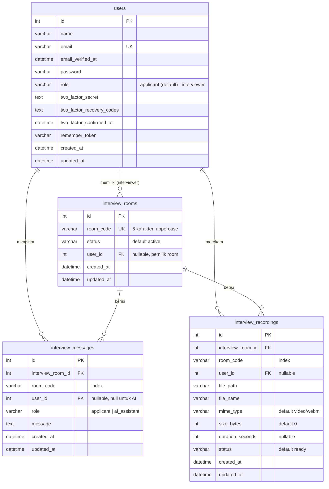

# Database

## Lokasi

| Lingkungan | Database |
| --- | --- |
| Lokal (development) | SQLite, file `database/database.sqlite` (tidak di-commit) |
| Tes (Pest) | SQLite `:memory:`, hilang setelah tes selesai |
| Production (rencana) | PostgreSQL, sesuai [spesifikasi](../AI_INTERVIEW_SPECIFICATIONS.md). Cukup ubah `DB_*` di `.env` lalu jalankan `php artisan migrate` |

Struktur tabel berasal dari migration di [database/migrations](../database/migrations). **Perubahan struktur selalu dibuat lewat migration baru**, bukan dengan mengedit tabel langsung.

Cara melihat struktur:

```bash
php artisan db:show
```

```bash
php artisan db:table interview_messages
```

Untuk tampilan visual, buka `database/database.sqlite` dengan DB Browser for SQLite, TablePlus, DBeaver, atau ekstensi SQLite Viewer di VS Code.

## ERD



## Tabel Aplikasi

### `users`
Akun login dari Fortify, ditambah kolom `role` (index). User yang mendaftar lewat UI otomatis mendapat role `applicant`.

### `interview_rooms`
Satu baris mewakili satu sesi interview.
- `room_code`: kode 6 karakter acak, unik. Dipakai di URL `/rooms/{CODE}`.
- `status`: hanya `active` yang bisa dibuka. Belum ada fitur untuk menutup room.
- `user_id`: interviewer pembuat room. Interviewer lain mendapat 403.

### `interview_messages`
Riwayat percakapan di room, sekaligus konteks yang dikirim ke AI.
- `role`: `applicant` atau `ai_assistant` (enum di migration).
- `user_id`: `null` untuk pesan AI.
- **Catatan:** pesan yang dikirim interviewer saat ini juga tersimpan sebagai `applicant`, karena enum belum punya nilai `interviewer`. Lihat [KNOWN_ISSUES.md](KNOWN_ISSUES.md).

### `interview_recordings`
Metadata rekaman video. File aslinya ada di `storage/app/public/{file_path}`.

### Relasi & penghapusan
- Room dihapus: semua pesan dan rekamannya ikut terhapus (`cascade`). **File di disk tidak ikut terhapus.**
- User dihapus: `user_id` di tabel lain diisi `null` (`set null`).

## Tabel Bawaan Laravel

| Tabel | Kegunaan |
| --- | --- |
| `sessions` | Session login (`SESSION_DRIVER=database`) |
| `cache`, `cache_locks` | Cache, termasuk data presence room (`CACHE_STORE=database`) |
| `jobs`, `job_batches`, `failed_jobs` | Antrian queue (`QUEUE_CONNECTION=database`) |
| `password_reset_tokens` | Reset password |
| `passkeys` | Login passkey (WebAuthn) |
| `migrations` | Catatan migration yang sudah dijalankan |

## Data di Luar Tabel

| Data | Lokasi |
| --- | --- |
| Peserta aktif room | Cache key `interview-room-presence:{CODE}`, TTL 45 detik |
| File video rekaman | `storage/app/public/recordings/{CODE}/rec_{CODE}_{waktu}_{acak}.webm` |
| File audio untuk AI | `storage/app/public/audio/{CODE}/audio_ai_{CODE}_{waktu}_{acak}.webm` |
| Prototype `/interview` | Session key `prototype_interview` (tidak masuk tabel) |

## Rencana Tabel (dari spesifikasi)

Belum dibuat. Dibutuhkan untuk evaluasi AI dan mode multi-applicant:

| Tabel | Isi |
| --- | --- |
| `interview_participants` | Applicant per room/sesi, agar setiap applicant punya riwayat AI sendiri |
| `interview_questions` | Pertanyaan yang diajukan AI beserta tipe dan tujuannya |
| `interview_results` | Skor, kelebihan, kekurangan, ringkasan, dan rekomendasi |
| `interview_violations` | Riwayat pelanggaran proctoring (saat ini hanya di-broadcast) |
| Kolom konteks di `interview_rooms` | Posisi, job description, bahasa, jumlah pertanyaan |
