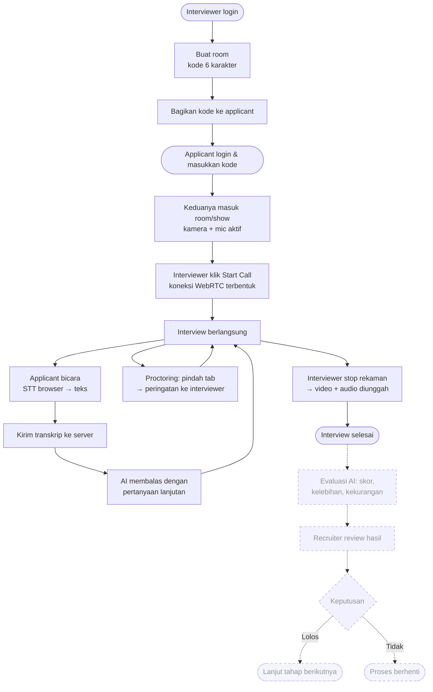
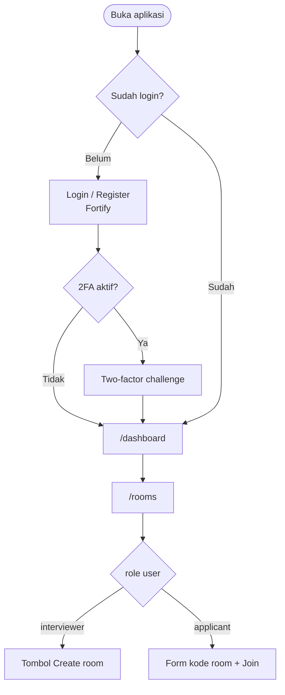
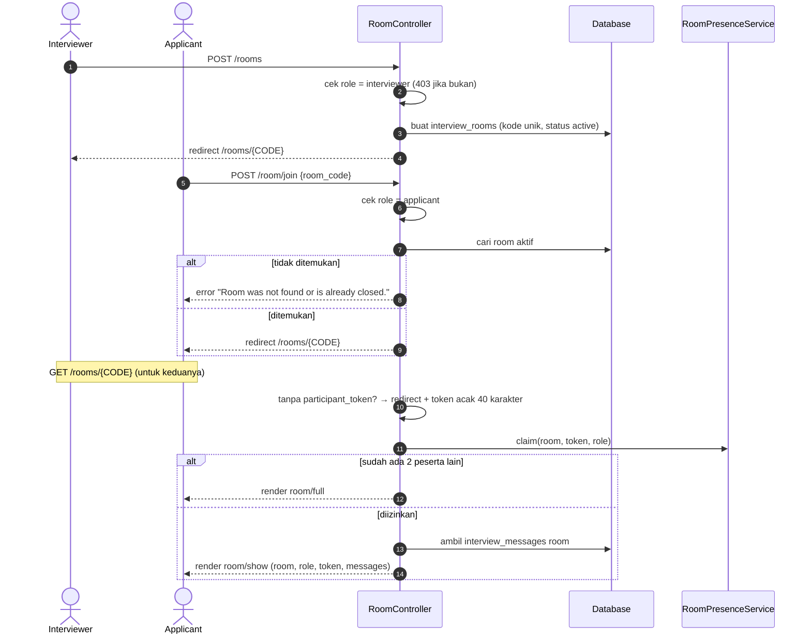
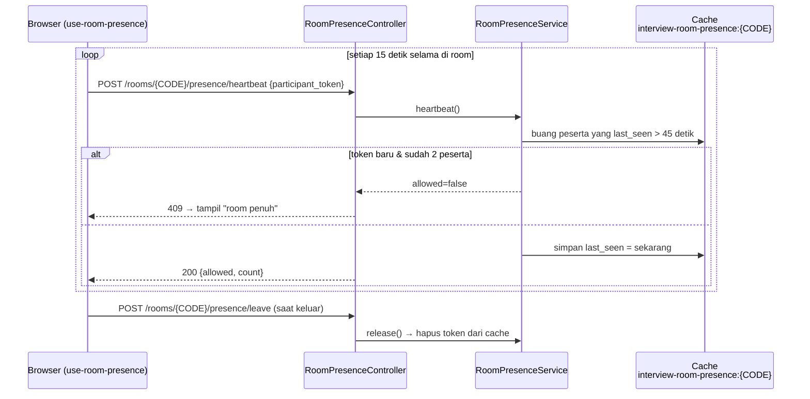
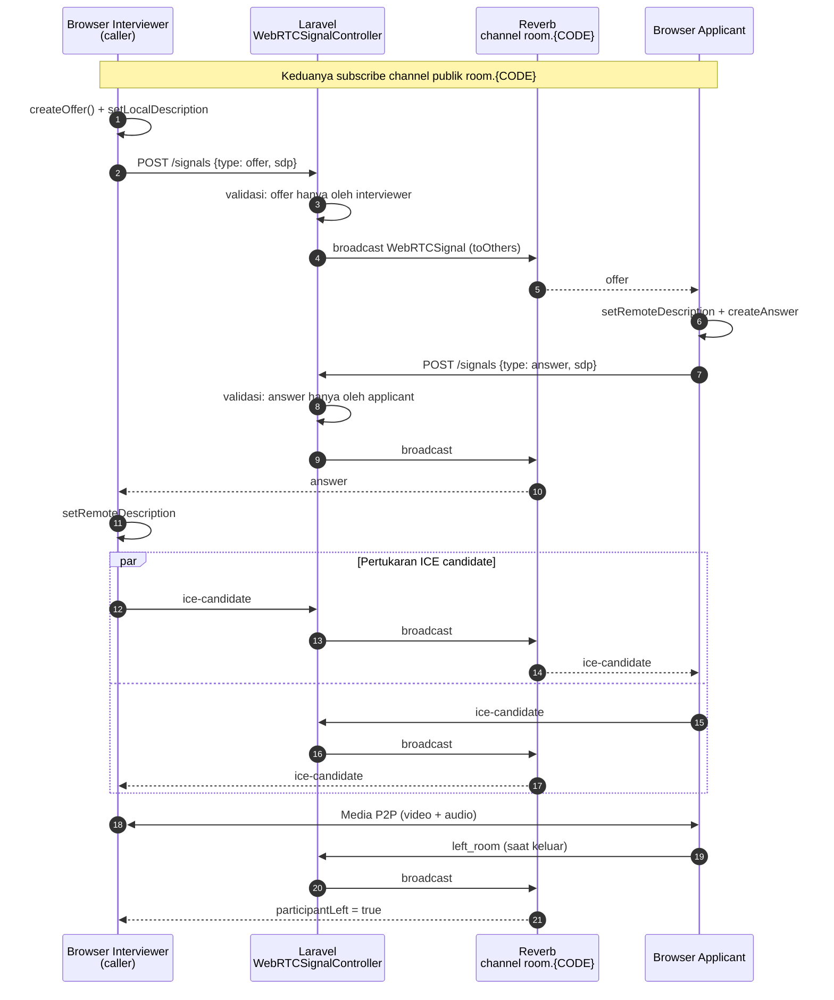
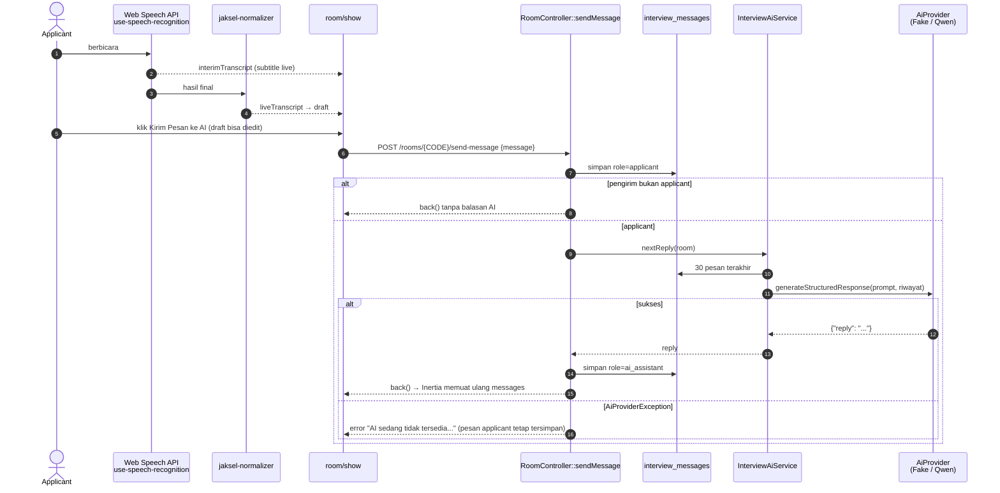
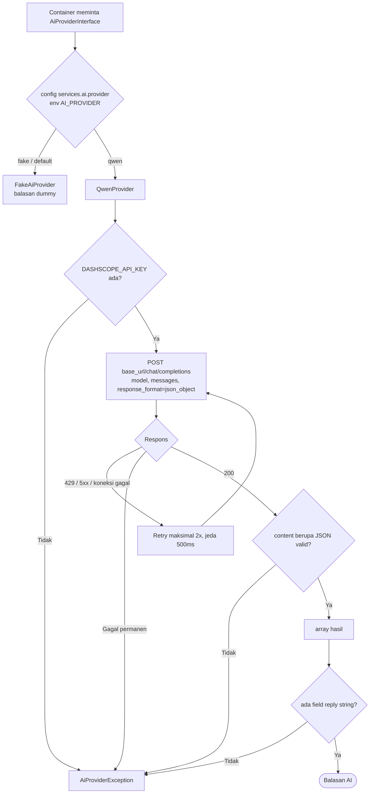
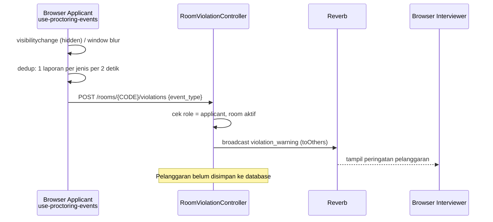
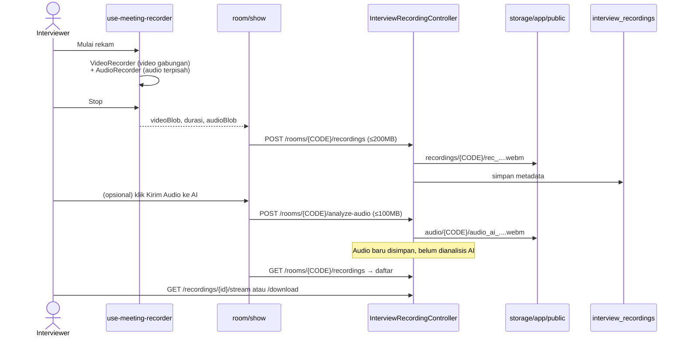
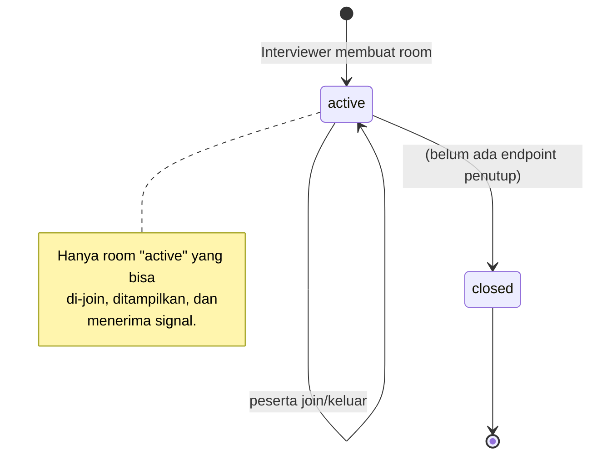

# Flow Diagram

Diagram alur utama aplikasi, sesuai kode saat ini. Diagram ditulis dengan Mermaid dan dirender otomatis oleh GitHub, VS Code (ekstensi *Markdown Preview Mermaid Support*), atau [mermaid.live](https://mermaid.live).

Daftar isi:
1. [Alur bisnis end-to-end](#1-alur-bisnis-end-to-end)
2. [Login & role](#2-login--role)
3. [Membuat & join room](#3-membuat--join-room)
4. [Presence (batas 2 peserta)](#4-presence-batas-2-peserta)
5. [Signaling WebRTC](#5-signaling-webrtc)
6. [Speech-to-text → AI](#6-speech-to-text--ai)
7. [Pemilihan provider AI](#7-pemilihan-provider-ai)
8. [Proctoring applicant](#8-proctoring-applicant)
9. [Rekaman meeting](#9-rekaman-meeting)
10. [Status room](#10-status-room)

---

## 1. Alur bisnis end-to-end

Garis putus-putus menandai bagian yang belum dibuat.

## 2. Login & role

Registrasi lewat UI selalu menghasilkan role `applicant`. Interviewer dibuat lewat seeder atau database.

## 3. Membuat & join room

## 4. Presence (batas 2 peserta)

## 5. Signaling WebRTC

Server hanya meneruskan pesan. Video dan audio mengalir langsung antar-browser.

## 6. Speech-to-text → AI

## 7. Pemilihan provider AI

## 8. Proctoring applicant

## 9. Rekaman meeting

## 10. Status room

Target state machine interview yang lebih lengkap (`waiting → in_progress → evaluating → completed / failed`) ada di [AI_INTERVIEW_SPECIFICATIONS.md](../AI_INTERVIEW_SPECIFICATIONS.md) bagian 10.
