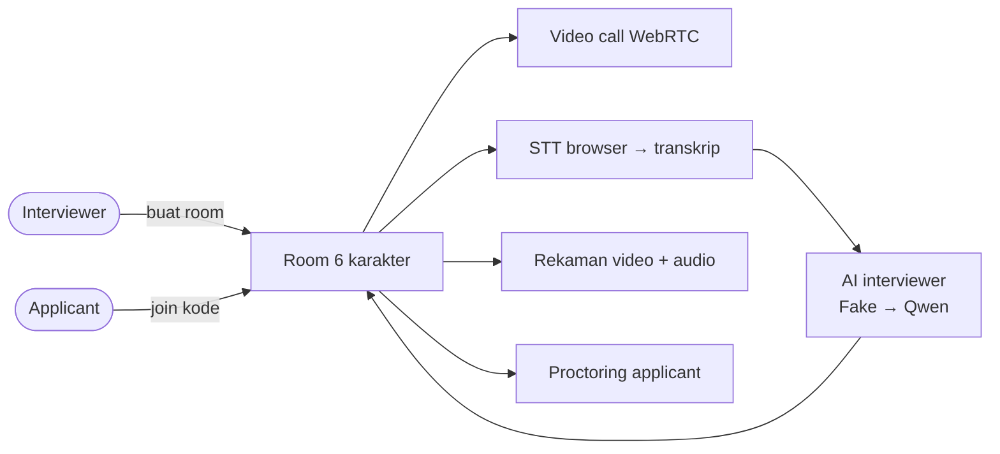

# Dokumentasi ai-int-test

Platform interview kerja online yang nantinya dipandu AI (Alibaba Qwen).

| Dokumen | Isi |
| --- | --- |
| [ARCHITECTURE.md](ARCHITECTURE.md) | Tech stack, diagram sistem, struktur folder, komponen backend & frontend, role |
| [FLOWS.md](FLOWS.md) | Flow diagram: alur bisnis, login, room, presence, WebRTC, STT → AI, proctoring, rekaman |
| [DATABASE.md](DATABASE.md) | Lokasi database, ERD, penjelasan tabel, rencana tabel baru |
| [ROUTES.md](ROUTES.md) | Semua endpoint HTTP & channel WebSocket |
| [SETUP.md](SETUP.md) | Instalasi, menjalankan aplikasi, variabel `.env`, testing |
| [AI_INTEGRATION.md](AI_INTEGRATION.md) | Status integrasi Qwen, cara mengaktifkan, istilah perusahaan, multi-applicant |
| [KNOWN_ISSUES.md](KNOWN_ISSUES.md) | Masalah keamanan, fungsional, dan technical debt yang diketahui |
| [../AI_INTERVIEW_SPECIFICATIONS.md](../AI_INTERVIEW_SPECIFICATIONS.md) | Spesifikasi target modul AI |

## Ringkasan Singkat

Mulai dari [SETUP.md](SETUP.md) untuk menjalankan aplikasi, lalu [ARCHITECTURE.md](ARCHITECTURE.md) untuk memahami struktur kodenya.
