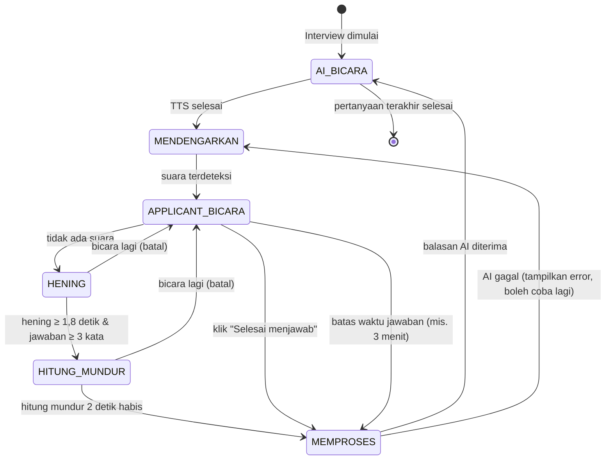
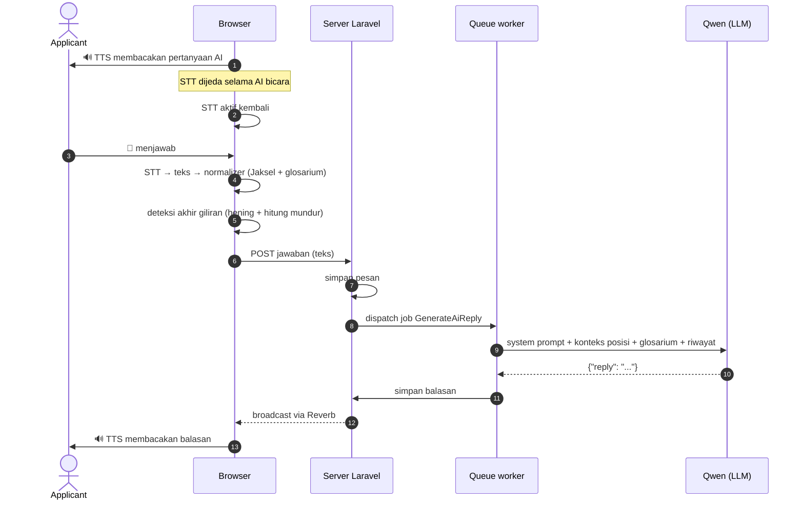
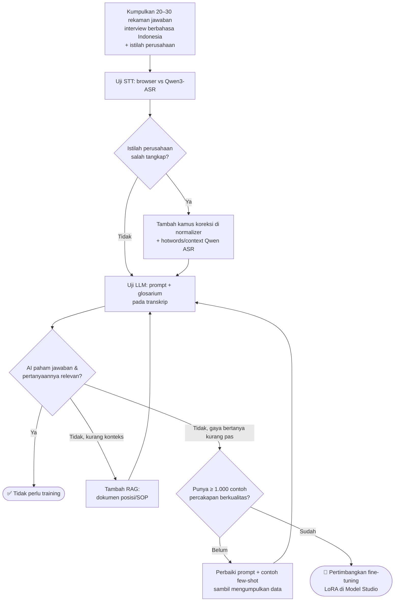

# 🗺️ Roadmap — AI Interview Platform

| Properti | Nilai |
| --- | --- |
| 👤 Owner | Muhammad Radhitya Utomo |
| 📌 Status | 🟡 In progress: fondasi selesai, AI menunggu akses model |
| 🧱 Tech stack | Laravel 13 · Inertia + React 19 + TypeScript · Reverb (WebSocket) · WebRTC · Web Speech API · Qwen (Alibaba) |
| 🗓️ Terakhir diperbarui | 9 Nov 2026 |
| 🔗 Dokumen terkait | [Arsitektur](ARCHITECTURE.md) · [Flow](FLOWS.md) · [Database](DATABASE.md) · [Integrasi AI](AI_INTEGRATION.md) · [Known issues](KNOWN_ISSUES.md) |

> 💡 **Tujuan:** website interview kerja di mana **AI berperan sebagai pewawancara**. AI mengajukan pertanyaan dalam Bahasa Indonesia, mendengarkan jawaban kandidat lewat suara, lalu menghasilkan penilaian yang direview recruiter.

> 📥 **Cara pakai di Notion:** buat halaman baru, lalu pilih *Import → Markdown* dan unggah file ini, atau salin semua teks lalu tempel. Checkbox `- [ ]` otomatis menjadi blok *To-do*, dan blok `mermaid` menjadi diagram.

---

## 📍 Kondisi Saat Ini

- [x] Interview 2 pihak (interviewer ↔ applicant) dengan **room code** 6 karakter
- [x] Video call WebRTC + signaling realtime (Reverb)
- [x] **Proctoring**: applicant wajib fullscreen, pindah tab/jendela dilaporkan ke interviewer
- [x] Speech-to-text di browser, mode campuran Indonesia–Inggris
- [x] Rekaman video + audio terpisah
- [x] Indikator border hijau saat ada yang bicara
- [x] Lapisan AI siap pakai (`FakeAiProvider` → `QwenProvider`), tinggal isi API key
- [x] Dokumentasi proyek (`docs/`)
- [ ] **AI sungguhan**: menunggu akses model Qwen
- [x] Database pindah ke **PostgreSQL** (di Docker, masih di laptop)
- [ ] **Belum di-deploy**
- [x] Menjalankan aplikasi dengan **satu perintah**: `docker compose up -d` (app, Reverb, queue, Vite, PostgreSQL, Redis)

> ℹ️ Untuk development, keempat proses itu sudah bisa dijalankan dengan **satu perintah**: `composer run dev`. Di production, `npm run dev` tidak dipakai lagi: frontend cukup di-*build* sekali (`npm run build`), dan proses lain dijalankan otomatis oleh server (lihat Fase 5).

---

## 🧭 Ringkasan Fase

| Fase | Fokus | Butuh API Qwen? | Status |
| --- | --- | :---: | --- |
| 0 | Fondasi: PostgreSQL, keamanan, perbaikan bug | ❌ | 🟡 Berjalan: PostgreSQL & Docker dev selesai |
| 1 | Alur percakapan AI: giliran bicara, TTS, queue | ❌ | 🔲 Belum mulai |
| 2 | Uji bahasa Indonesia & keputusan training | ✅ | ⏸️ Menunggu akses |
| 3 | Integrasi Qwen sungguhan | ✅ | ⏸️ Menunggu akses |
| 4 | Penilaian AI & dashboard recruiter | ❌ (bisa di-mock) | 🔲 Belum mulai |
| 5 | Deployment (Docker, server, HTTPS) | ❌ | 🔲 Belum mulai |
| 6 | Multi-applicant dalam satu sesi | ❌ | ❓ Menunggu keputusan model A/B |

> ✅ Fase 0, 1, 4, dan 5 **tidak perlu menunggu** API. Semuanya bisa dikerjakan dan dites dengan `FakeAiProvider`.

---

## 🧱 Fase 0 — Fondasi

**Tujuan:** aplikasi aman dan siap dipakai lebih dari satu orang.

### Database
- [x] Install PostgreSQL: PostgreSQL 18 di Docker (service `pgsql`, port host `5433`)
- [x] Ubah `.env` → `DB_CONNECTION=pgsql`, lalu migrate + seed (semua migration jalan di PostgreSQL)
- [x] Update `.env.example` dengan konfigurasi PostgreSQL
- [x] Pindahkan cache, session, dan queue ke **Redis**. Signal WebRTC sekalian dibuat `ShouldBroadcastNow` agar tidak menunggu worker queue
- [ ] CI: tambah job tes dengan PostgreSQL (tes lokal tetap boleh SQLite `:memory:`)

> ❓ **Kenapa sekarang?** Data saat ini hanya data uji, jadi biaya pindahnya hampir nol. SQLite akan sering *locked* begitu ada queue AI dan banyak applicant menulis bersamaan.

### Keamanan (dari [Known issues](KNOWN_ISSUES.md))
- [ ] Ganti channel `room.{CODE}` dari publik ke **private channel** + otorisasi
- [ ] Batasi stream/download rekaman hanya untuk interviewer pemilik room
- [ ] Pindahkan file rekaman dari disk `public` ke disk privat
- [ ] Cek keikutsertaan user di `sendMessage`, rekaman, dan `analyze-audio`
- [ ] Lindungi atau hapus prototype `/interview` (tanpa login)

### Perbaikan fungsional
- [x] Tambah role `interviewer` di `interview_messages`, agar pesan interviewer tidak dibaca AI sebagai jawaban kandidat
- [ ] Endpoint **End interview**: ubah status room menjadi `closed`
- [ ] Simpan pelanggaran proctoring ke tabel `interview_violations`
- [x] Pasang halaman `room/lobby` (cek kamera/mic) sebelum masuk room; pilihan perangkat terbawa ke room, applicant langsung layar penuh
- [x] Cara membuat akun interviewer: `php artisan interviewer:create`
- [ ] Halaman admin untuk mengelola akun interviewer (saat tim HR non-teknis membutuhkannya)

---

## 🗣️ Fase 1 — Alur Percakapan AI (Turn-Taking)

**Tujuan:** AI tahu **kapan applicant selesai menjawab** dan **kapan AI mulai bicara**, tanpa harus menekan tombol "Kirim" setiap kali.

### Konsep: state machine giliran bicara

### Aturan deteksi "applicant selesai bicara"
Gabungan beberapa sinyal, karena satu sinyal saja tidak cukup andal:

| Sinyal | Sumber | Fungsi |
| --- | --- | --- |
| Volume mic (VAD) | `use-voice-activity` (sudah ada) | Mendeteksi bicara atau hening secara realtime |
| Hasil *final* STT | `use-speech-recognition` (sudah ada) | Memastikan kalimat sudah ditranskripsi penuh |
| Durasi hening | Timer baru | Default **1,8 detik**, bisa diatur |
| Panjang jawaban minimal | Hitung kata | Mencegah kiriman "eee…" atau jawaban kosong |
| Kata pengisi di akhir | Kamus ("jadi…", "terus…", "eee", "hmm") | Kalau kalimat berakhir dengan kata pengisi, waktu hening diperpanjang |
| Tombol manual | UI | **"Selesai menjawab"** sebagai cadangan, selalu tersedia |
| Batas waktu | Timer | Peringatan di menit ke-2,5, kirim otomatis di menit ke-3 |

### Checklist
- [ ] Hook `use-turn-taking`: state machine di atas, menggabungkan VAD + STT + timer
- [ ] Indikator UI per state: "AI sedang bicara", "Silakan menjawab", "Mengirim dalam 2… 1…", "AI sedang berpikir"
- [ ] Hitung mundur yang **batal otomatis** kalau applicant bicara lagi
- [ ] Tombol "Selesai menjawab" + batas waktu jawaban
- [ ] **Matikan STT saat AI bicara**, supaya suara AI dari speaker tidak ikut tertranskripsi
- [ ] Konfigurasi ambang (hening, kata minimal, batas waktu) di `config/interview.php`
- [ ] **Text-to-speech** untuk pertanyaan AI. Tahap awal pakai `speechSynthesis` browser dengan suara `id-ID` (gratis, tanpa API)
- [ ] Panggilan AI lewat **queue job**, balasan dikirim lewat Reverb (tidak menggantung request)
- [ ] Indikator loading saat AI memproses + tombol coba lagi saat gagal
- [ ] Uji dengan `FakeAiProvider`: alur lengkap tanpa API

### Alur data STT → AI → suara

---

## 🇮🇩 Fase 2 — Uji Bahasa Indonesia & Keputusan Training

**Tujuan:** menjawab pertanyaan *"apakah Qwen bisa Bahasa Indonesia, atau perlu training?"* dengan **data uji**, bukan asumsi.

### Yang sudah diketahui

| Komponen | Fungsi | Bahasa Indonesia | Catatan |
| --- | --- | --- | --- |
| **Qwen LLM** (`qwen-plus`, dll.) | Memahami jawaban & membuat pertanyaan | ✅ Bisa, tanpa training | Model multibahasa |
| **Qwen3-ASR** (suara → teks) | Alternatif STT browser | ✅ Versi open-source mendukung Indonesia | Perlu dicek apakah versi **API Model Studio** juga mendukung |
| **Qwen TTS** (teks → suara) | Suara AI | ⚠️ Belum terlihat mendukung Indonesia | Pakai TTS browser `id-ID`, atau TTS lain (Google/Azure) |
| **STT browser** (sekarang) | Suara → teks | ✅ `id-ID` didukung | Gratis, terbaik di Chrome/Edge |

> 🎯 **Kesimpulan awal:** "Dub Indonesia" tidak perlu training. **Memahami** Bahasa Indonesia sudah bisa. Yang perlu dipilih adalah **mesin suara** (STT/TTS) yang mendukung Indonesia, dan **istilah perusahaan** cukup ditangani lewat glosarium.

### Alur keputusan training

### Checklist
- [ ] Konfirmasi ke pemberi akses: region akun, model yang diizinkan, rate limit, biaya
- [ ] Cek di console Model Studio: apakah **Qwen3-ASR** dan **Qwen TTS** di region kalian mendukung `id`
- [ ] Siapkan **glosarium istilah perusahaan** (istilah, arti, salah ucap umum)
- [ ] Kumpulkan 20–30 rekaman uji (beragam aksen, campuran Inggris, istilah internal)
- [ ] Ukur akurasi STT: browser vs Qwen3-ASR (persentase kata/istilah yang salah)
- [ ] Uji LLM: prompt + glosarium → apakah pertanyaan lanjutan relevan
- [ ] Uji suara TTS `id-ID` di browser target (Chrome/Edge di Windows, Android)
- [ ] **Catat keputusan:** perlu training atau tidak, plus mesin STT/TTS yang dipilih

### Jika ternyata perlu training
- [ ] Kumpulkan dan anonimkan data percakapan (hapus nama atau data pribadi kandidat)
- [ ] Format ke dataset chat (system / user / assistant), target ≥ 1.000 contoh
- [ ] Cek model yang bisa di-fine-tune di region akun (tidak semua model bisa)
- [ ] Training LoRA → evaluasi dengan set uji yang sama → bandingkan dengan versi prompt saja
- [ ] Hitung biaya training dan hosting model hasil fine-tune

> ⚠️ Fine-tuning cocok untuk **gaya** wawancara, **bukan** untuk menghafal istilah atau fakta. Istilah tetap lebih baik lewat glosarium atau RAG, karena bisa diubah kapan saja tanpa training ulang.

---

## 🤖 Fase 3 — Integrasi Qwen

**Prasyarat:** API key sudah ada.

- [ ] Isi `.env`: `AI_PROVIDER=qwen`, `DASHSCOPE_API_KEY`, `QWEN_MODEL`, `QWEN_BASE_URL` (sesuai region)
- [ ] Uji koneksi dengan satu sesi interview penuh
- [ ] Setel prompt pewawancara (`config/interview.php`) + glosarium
- [ ] Tambah **konteks interview** per room: posisi, job description, jumlah pertanyaan, bahasa
- [ ] AI memulai interview lebih dulu (salam + pertanyaan pembuka)
- [ ] AI menutup interview setelah N pertanyaan
- [ ] Rate limit per room/applicant + penanganan error 429
- [ ] Catat pemakaian token per interview untuk memantau biaya
- [ ] Logging tanpa data pribadi kandidat
- [ ] (Opsional) Ganti STT/TTS ke Qwen jika hasil Fase 2 lebih baik

---

## 📊 Fase 4 — Penilaian AI & Dashboard Recruiter

- [ ] Tabel `interview_results`: skor, kelebihan, kekurangan, ringkasan, rekomendasi
- [ ] Prompt evaluasi dengan output JSON + validasi (rubrik penilaian konsisten)
- [ ] Job evaluasi otomatis setelah interview selesai
- [ ] Halaman **review recruiter**: daftar kandidat, transkrip, rekaman, pelanggaran proctoring, hasil AI
- [ ] Keputusan recruiter: **Lolos / Tidak lolos**, beserta catatan
- [ ] Keputusan akhir tetap di tangan manusia. AI hanya memberi rekomendasi
- [ ] Ekspor hasil (PDF/CSV)

---

## 🚀 Fase 5 — Deployment

### Apa yang harus jalan di server?

| Proses | Lokal (sekarang) | Production |
| --- | --- | --- |
| Web app | `php artisan serve` | Nginx + PHP-FPM (atau FrankenPHP) |
| Frontend | `npm run dev` | **Tidak jalan.** Cukup `npm run build` saat deploy |
| WebSocket | `php artisan reverb:start` | Proses Reverb yang selalu hidup, lewat **WSS** (HTTPS) |
| Queue | `php artisan queue:listen` | Worker yang selalu hidup (`queue:work`) |
| Database | SQLite file | PostgreSQL |
| Cache/queue store | Database | Redis |
| TURN server | — | **coturn**, agar video tetap tersambung di jaringan kantor |
| HTTPS | — | **Wajib.** Kamera/mic hanya bisa diakses lewat HTTPS |

### Perlu Docker?

**Tidak wajib, tapi direkomendasikan** untuk proyek ini, karena aplikasinya terdiri dari banyak proses (web, Reverb, queue, PostgreSQL, Redis, coturn) yang harus selalu hidup bersamaan.

| Opsi | Kelebihan | Kekurangan | Cocok jika |
| --- | --- | --- | --- |
| **A. Docker Compose di VPS** ⭐ | Satu file mendefinisikan semua service, mudah dipindah, lokal = production | Perlu belajar Docker, Dockerfile production harus dibuat sendiri (Sail hanya untuk dev) | Perusahaan punya server sendiri atau akun Alibaba Cloud (ECS) |
| B. Laravel Forge / Ploi (tanpa Docker) | Panel otomatis: Nginx, SSL, supervisor untuk queue & Reverb | Berbayar, server terikat satu konfigurasi | Tim kecil yang ingin cepat online |
| C. Platform terkelola (mis. Laravel Cloud) | Tanpa urus server | Lebih mahal, dukungan Reverb/TURN perlu dicek | Tidak ada tim infrastruktur |

> 💡 **Rekomendasi:** **Docker Compose di Alibaba Cloud ECS**, di region yang sama atau dekat dengan endpoint Qwen. Latensi ke AI jadi rendah, dan data kandidat tetap di satu penyedia. Untuk development, Docker **tidak wajib**, karena `composer run dev` sudah cukup.

### Checklist
- [ ] Putuskan opsi hosting (A/B/C) dan anggaran server
- [x] Docker Compose untuk **development** (`compose.yaml` + `docker/Dockerfile`), sebagai dasar versi production
- [ ] Dockerfile production (PHP 8.3+, ekstensi `pdo_pgsql`, `redis`) + `docker-compose.yml`: `app`, `reverb`, `queue`, `scheduler`, `postgres`, `redis`, `coturn`
- [ ] Domain + sertifikat HTTPS (Let's Encrypt)
- [ ] Reverb di belakang reverse proxy dengan **WSS**
- [ ] TURN server (coturn) + konfigurasi `iceServers` dari `.env`
- [ ] Penyimpanan rekaman: volume persisten atau object storage (Alibaba OSS / S3)
- [ ] Batas upload PHP & Nginx ≥ 200 MB
- [ ] CI/CD: tes → build image → deploy otomatis dari branch `master`
- [ ] Backup database harian + uji restore
- [ ] Monitoring error (Sentry) + log
- [ ] Environment **staging** untuk uji sebelum production

### Kepatuhan data
- [ ] Persetujuan (consent) kandidat untuk rekaman & pemrosesan AI
- [ ] Kebijakan retensi: berapa lama rekaman dan transkrip disimpan, lalu dihapus otomatis
- [ ] Sesuaikan dengan **UU Pelindungan Data Pribadi (UU PDP)** Indonesia
- [ ] Pastikan kebijakan data Alibaba (lokasi server, penggunaan data untuk training) disetujui perusahaan

---

## 👥 Fase 6 — Multi-Applicant dalam Satu Sesi

> ❓ **Butuh keputusan:** model mana yang dimaksud requirement? Detailnya ada di [Integrasi AI → Multi-applicant](AI_INTEGRATION.md#multi-applicant-dalam-satu-sesi).

- [ ] **Putuskan model:** A. interview paralel (⭐ direkomendasikan) atau B. group interview
- [ ] Tabel `interview_participants`, dengan riwayat AI per applicant
- [ ] Ganti batas 2 peserta dengan kapasitas sesi yang bisa diatur
- [ ] Dashboard pantau untuk recruiter (banyak kandidat sekaligus)
- [ ] Uji beban: N applicant bersamaan vs rate limit Qwen
- [ ] (Hanya model B) Media server SFU (mis. LiveKit) + pengaturan giliran bicara antar-applicant

---

## ❓ Pertanyaan Terbuka & Keputusan

| # | Pertanyaan | Ditanyakan ke | Status | Keputusan |
| --- | --- | --- | --- | --- |
| 1 | Region akun Qwen & model yang diizinkan | Pemberi akses API | ⏳ Menunggu | — |
| 2 | Rate limit & anggaran biaya AI per bulan | Pemberi akses / manajemen | ⏳ Menunggu | — |
| 3 | Apakah Qwen3-ASR & Qwen TTS (API) mendukung `id` di region kita | Console Model Studio | 🔲 Belum dicek | — |
| 4 | Multi-applicant: model A (paralel) atau B (group) | Pemilik requirement | 🔲 Belum diputuskan | — |
| 5 | Hosting: Docker di Alibaba ECS / Forge / terkelola | Tim / manajemen | 🔲 Belum diputuskan | — |
| 6 | Perlu fine-tuning? | Hasil uji Fase 2 | 🔲 Belum diuji | Dugaan awal: tidak perlu |
| 7 | Berapa lama rekaman & transkrip disimpan | HR / legal | 🔲 Belum dibahas | — |

## ⚠️ Risiko

| Risiko | Dampak | Mitigasi |
| --- | --- | --- |
| Akses API Qwen lama turun | Fase 2–3 tertunda | Kerjakan Fase 0, 1, 4, dan 5 dengan `FakeAiProvider` |
| STT salah tangkap istilah perusahaan | AI salah memahami jawaban | Glosarium + kamus normalizer, uji di Fase 2 |
| AI memotong jawaban kandidat | Pengalaman buruk, penilaian tidak adil | Hitung mundur yang bisa dibatalkan + tombol manual + ambang yang bisa diatur |
| Suara AI ikut tertranskripsi | Jawaban kandidat tercampur | Jeda STT saat TTS berjalan, sarankan pakai headset |
| Video gagal tersambung di jaringan kantor | Interview tidak bisa berjalan | TURN server (coturn) |
| Biaya token membengkak | Anggaran terlampaui | Batasi riwayat (30 pesan), rate limit, monitoring pemakaian |
| Kebocoran rekaman/data kandidat | Masalah hukum (UU PDP) | Selesaikan keamanan Fase 0 sebelum deploy, disk privat, retensi |

---

### 📚 Sumber
- [Qwen3-ASR (GitHub resmi)](https://github.com/QwenLM/Qwen3-ASR): daftar bahasa termasuk Indonesia
- [sherpa-onnx: Qwen3-ASR](https://k2-fsa.github.io/sherpa/onnx/qwen3-asr/index.html)
- [Model Studio: Qwen TTS](https://www.alibabacloud.com/help/en/model-studio/qwen-tts)
- [Model Studio: Improve ASR accuracy](https://www.alibabacloud.com/help/en/model-studio/improve-asr-accuracy)
- [Model Studio: Model training overview](https://www.alibabacloud.com/help/en/model-studio/model-training-overview)
